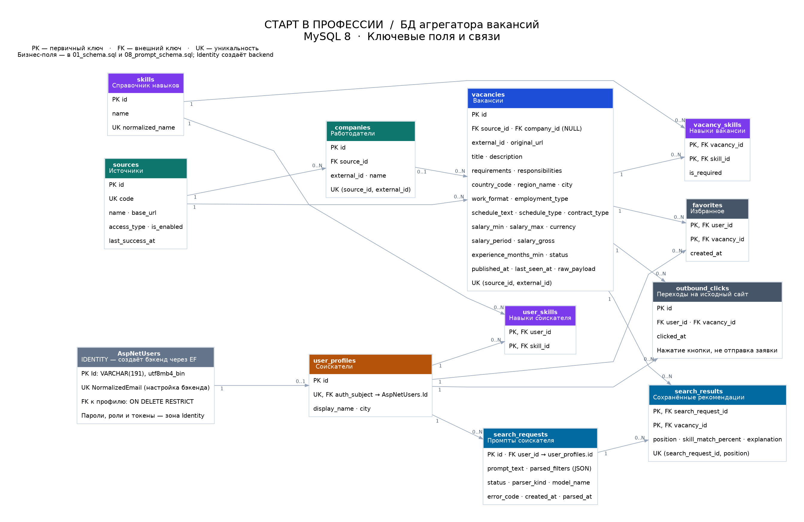

# СТАРТЕР — схема БД агрегатора вакансий

MySQL 8.4. Проектируем новую БД: сценариев обновления существующей базы и каталога миграций здесь нет. Код .NET не входит в этот репозиторий.

**Учётные записи, пароли, роли и Bearer/refresh-токены принадлежат ASP.NET Core Identity.** Его таблицы создаёт бэкенд через EF Core. Наша схема содержит 9 бизнес-таблиц; ещё 2 таблицы истории промптов вынесены в отдельный `08_prompt_schema.sql`.

[PDF](diagram.pdf) · [Mermaid](04_diagram.mmd) · [Разбор полученных правок](STARTER_REVIEW.md) · [Контракт с бэкендом](AUTH_AND_IMPORT.md)

## Порядок первоначального создания

1. Выполнить `01_schema.sql`: источники, компании, вакансии, профиль, навыки, избранное и переходы. Профили на этом этапе не заполнять.
2. Бэкендер создаёт Identity-таблицы из своего `IdentityDbContext<ApplicationUser>` в той же БД. Согласует версию EF/MySQL-провайдера, роли User/Admin, уникальность email и определения ключей по `AUTH_AND_IMPORT.md`.
3. Выполнить `identity/01_preflight.sql`, затем `identity/02_link_profile.sql`. Второй скрипт проверит определения и добавит FK `user_profiles.auth_subject → AspNetUsers.Id ON DELETE RESTRICT`. При неподготовленных ключах/email/orphan-профилях он остановится до добавления FK. Это шаг создания схемы, не перенос данных старой версии.
4. Если используется история промптов, выполнить отдельный `08_prompt_schema.sql`. Её JSON-контракт находится в `JSON_CONTRACT.md`, запросы — в `06_prompt_queries.sql`. Кеш ИИ-упрощений не добавлялся.
5. Для демонстрационного каталога один раз выполнить `03_seed.sql`. Он не создаёт аккаунтов или профилей, не содержит паролей и токенов.
6. Реальные демо-аккаунты создаёт бэкендер через Identity UserManager/API. По их проверенному ID вызывает QA02 из `05_auth_queries.sql`, затем при необходимости выполняет `07_demo_profile_seed.sql` с параметром `@auth_subject`.

Не выполняйте `tests/identity_stub.sql` при развёртывании. Это минимальная заглушка ключа/email для SQL-тестов, без паролей, ролей и работающей авторизации.

## Файлы

| Файл | Назначение |
|---|---|
| `01_schema.sql` | 9 бизнес-таблиц, индексы и ограничения |
| `identity/01_preflight.sql` | Проверка ключей Identity, orphan-ссылок и email-индекса |
| `identity/02_link_profile.sql` | Первоначальное подключение FK к готовой Identity-схеме |
| `02_queries.sql` | 12 операций: импорт, поиск, карточка, избранное и переходы |
| `03_seed.sql` | Только вымышленные объявления, компании, навыки и графики |
| `04_diagram.mmd`, `diagram.*` | Диаграмма бизнес-схемы и её связи с внешней таблицей Identity |
| `05_auth_queries.sql` | 3 операции профиля: получить, идемпотентно создать, изменить |
| `08_prompt_schema.sql`, `06_prompt_queries.sql` | Отдельная история промптов и сохранённых рекомендаций |
| `07_demo_profile_seed.sql` | Навыки и избранное уже существующего демо-профиля |
| `JSON_CONTRACT.md` | Формат результата ИИ-разбора и соответствие параметрам поиска |
| `SOURCES.md` | Источники данных; первым выбран API «Работы России», HH не включён в MVP |
| `STARTER_REVIEW.md` | Какие конфликты с присланными правками устранены |
| `verify.py`, `VERIFICATION.md` | SQL-проверки и их границы |

SQL-файлы запросов — справочники отдельных операций, не скрипты для запуска целиком. Параметры передаёт бэкенд через драйвер; не собирайте SQL конкатенацией. В SQL-редакторе параметры LIMIT заменяйте числами, в подготовленном запросе передавайте параметры. Все временные метки — UTC. Свободные часы пользователя не запрашиваются и не хранятся.

## Идентификаторы и доступ

`AspNetUsers.Id` — строковый ID учётной записи из проверенного principal. `user_profiles.auth_subject` хранит этот ID, имеет UNIQUE и после этапа подключения — FK с RESTRICT. `user_profiles.id` остаётся BIGINT: именно его все бизнес-таблицы используют в `user_id`. Существующие бизнес-связи не переименовывались.

Backend проверяет авторизацию и для каталога, и для персональных функций. Регистрация/вход доступны без неё. Роли и административные действия контролируются политиками ASP.NET Core: MySQL не знает роль HTTP-клиента. Из тела запроса нельзя брать владельца чужих данных. На клиенте MAUI токены хранятся через SecureStorage. Готовые Bearer-токены Identity не JWT; собственные таблицы сессий/refresh-токенов здесь не создаются.

Удаление аккаунта не удаляет профиль каскадом. Оно требует отдельного сценария очистки/сохранения бизнес-данных; FK запрещает случайное удаление аккаунта с существующим профилем.

## Промпт и поиск

Фокус MVP — постоянная работа. Пример: «Знаю C# и SQL, ищу удалённую работу на полный день, 5/2, от 60 тысяч». Текущие параметры для бэкенда перечислены в JSON_CONTRACT.md; Q11 удалён.

Пользователь пишет один рассказ о себе. Бэкенд/ИИ извлекает и валидирует условия по `JSON_CONTRACT.md`, сохраняет запрос через QP01/QP02, обновляет навыки и выполняет Q03. История хранит реальные найденные вакансии и объяснение; ИИ не создаёт объявлений.

`@work_format` выбирает офис, удалёнку или гибрид; `@schedule_type` — обычный график (5/2, сменный и т. д.); `@contract_type` — постоянный/срочный договор. NULL отключает соответствующий фильтр. `@experience_months` ограничивает требуемый стаж. Оплата сравнивается в одной валюте за одинаковый период; налоговая база уточняется отдельным фильтром. Показатель совпадения навыков не является вероятностью найма. Неизвестные условия помечаются unknown. Подбора по личному расписанию нет. Полный рабочий день и постоянный договор учитываются отдельно.

Отклик — сохранение перехода и открытие оригинала. Подтверждения отправки резюме на стороннем сайте у БД нет. Между разными сайтами одинаковые объявления пока остаются отдельными строками.

## Проверка

`python verify.py` использует локальный MySQL-контейнер `vacancy-db-check`, создаёт и удаляет две собственные временные БД. Тесты проверяют SQL и интеграционный контракт ключей/email на явно обозначенной заглушке. Настоящие EF-таблицы, UserManager, роли, HTTP-авторизацию и refresh-токены должен проверить бэкендер. Результаты находятся в `VERIFICATION.md`.
