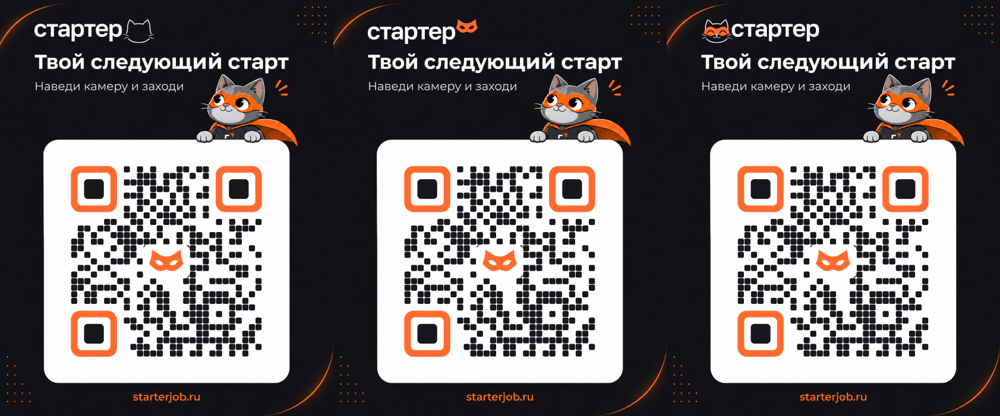

# QR-коды «Стартер»

Три карточки для **https://starterjob.ru** с исходными логотипами, без дополнительного квадратика в шапке. Белые поля вокруг QR уменьшены; сохранена свободная зона в четыре модуля.

| Вариант | Логотип | PNG | SVG | PDF |
| --- | --- | --- | --- | --- |
| 1 | Контур котика справа | [Скачать](starterjob-logo-1.png) | [Скачать](starterjob-logo-1.svg) | [Скачать](starterjob-logo-1.pdf) |
| 2 | Оранжевая маска справа | [Скачать](starterjob-logo-2.png) | [Скачать](starterjob-logo-2.svg) | [Скачать](starterjob-logo-2.pdf) |
| 3 | Улыбающийся котик слева | [Скачать](starterjob-logo-3.png) | [Скачать](starterjob-logo-3.svg) | [Скачать](starterjob-logo-3.pdf) |

PNG: **2244 × 2804 px**. SVG и PDF содержат векторный QR и встроенные растровые иллюстрации и логотипы.

Палитра QR: оранжевый `#FF6B2F`, графитовый `#17171C`, белый `#FFFFFF`.

Все три QR проверены декодером ZXing: исходный размер, уменьшение до ширины 1122 / 561 / 337 px, оттенки серого, лёгкое размытие и поворот. Пройдено **21 из 21** проверок; результаты — в [validation.json](validation.json).
